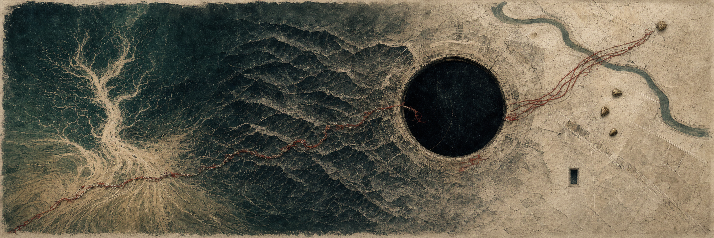

  

<h1 align="center">Mushfique Shahriar Aurnab</h1>

  <code>CS × EE</code>&nbsp;&nbsp;
  <code>motion data</code>&nbsp;&nbsp;
  <code>machine learning</code>&nbsp;&nbsp;
  <code>research software</code>

  I am a DGIST undergraduate studying computer science and electrical engineering.

  
  

### Current research

I am studying what neural networks remember from earlier tasks after they learn new ones, and whether that information can still be recovered when their accuracy drops.

### Selected projects

<table>
  <tr>
    <td width="42" align="center"></td>
    <td>
      <strong><a href="https://github.com/mushfique-dgist/gpx-motion-analysis">GPX Motion Analysis</a></strong> 
      Compares GPS tracks from the same trip, even when the recordings start at different times or contain gaps. 
      <code>Python</code> <code>GPX</code> <code>data analysis</code>
    </td>
  </tr>
  <tr>
    <td width="42" align="center"></td>
    <td>
      <strong><a href="https://github.com/mushfique-dgist/vox-pop">Vox Pop</a></strong> 
      Searches nine public discussion sites from one command and puts the results in one place. 
      <code>Python</code> <code>search</code> <code>command line</code>
    </td>
  </tr>
  <tr>
    <td width="42" align="center"></td>
    <td>
      <strong><a href="https://github.com/mushfique-dgist/course_extractor">Course Extractor</a></strong> 
      Collects course listings from university websites and saves them as clean JSON and Markdown. The Harvard test run found 508 courses without page errors. 
      <code>Python</code> <code>web scraping</code> <code>data export</code>
    </td>
  </tr>
  <tr>
    <td width="42" align="center"></td>
    <td>
      <strong><a href="https://github.com/mushfique-dgist/nypc_code_battle">Code Battle AI</a></strong> 
      An AI player for MapleStory Code Battle. It reads the board from the screen and looks a few moves ahead before suggesting a move. 
      <code>Python</code> <code>OpenCV</code> <code>game AI</code>
    </td>
  </tr>
</table>

### Toolkit

  
  
  
  
  
  
  
  

