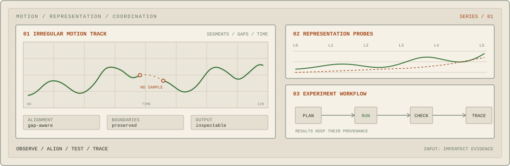

  <picture>
    <source media="(prefers-color-scheme: dark)" srcset="assets/signal-console-dark.svg">
    
  </picture>

# Mushfique Shahriar Aurnab

DGIST undergraduate working across computer science and electrical engineering. I build small systems for messy evidence: motion traces, continual-learning diagnostics, and tools for agents.

[CV](assets/Mushfique_Shahriar_Aurnab_CV.pdf) · [Email](mailto:mushfique@dgist.ac.kr)

## Selected work

- **[GPX Motion Analysis](https://github.com/mushfique-dgist/gpx-motion-analysis)** aligns irregular tracks without treating long gaps as observed motion.
- **[Vox Pop](https://github.com/mushfique-dgist/vox-pop)** searches public discussions across nine sources through a Python library, CLI, and MCP server.
- **[Course Extractor](https://github.com/mushfique-dgist/course_extractor)** combines FOSE discovery, JSON-LD, and HTML fallbacks; its Harvard DCE run collected 508 courses with no reported page errors.
- **[Code Battle AI](https://github.com/mushfique-dgist/nypc_code_battle)** joins screen perception, summed-area move generation, and 3-ply minimax.

## Research

I am testing where old-task information survives after sequential learning, and when recovery is a classifier problem rather than a representation problem.
