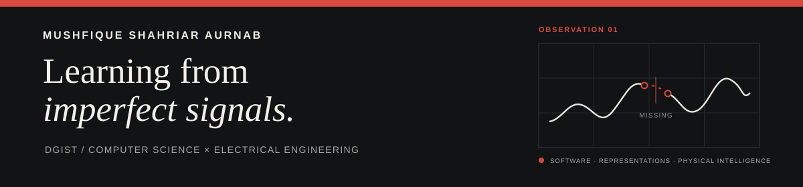

  

  <a href="assets/Mushfique_Shahriar_Aurnab_CV.pdf">Curriculum vitae</a> ·
  <a href="mailto:mushfique@dgist.ac.kr">Email</a> ·
  <a href="https://www.dgist.ac.kr/en/">DGIST</a>

I build learning systems that stay honest about imperfect signals, from motion traces and neural representations to agent workflows.

### Selected work

| Project | What I built | Evidence |
| --- | --- | --- |
| **[GPX Motion Analysis](https://github.com/mushfique-dgist/gpx-motion-analysis)** | Gap-aware alignment and segment-safe motion analysis for irregular tracks | Tested CLI, reproducible fixtures, Python 3.11–3.14 CI |
| **[Vox Pop](https://github.com/mushfique-dgist/vox-pop)** | Semantic routing and retrieval across public discussions | 9 sources, Python library, CLI, and MCP server |
| **[Course Extractor](https://github.com/mushfique-dgist/course_extractor)** | FOSE discovery with JSON-LD and HTML fallbacks | 508 Harvard DCE courses, 0 reported page errors |
| **[Code Battle AI](https://github.com/mushfique-dgist/nypc_code_battle)** | Screen perception joined to adversarial search | OpenCV, summed-area move generation, 3-ply minimax |

### Questions I am exploring

- When is model failure a readout problem rather than representation loss?
- How should a system preserve missing sensor evidence instead of silently filling it in?
- How can agents coordinate experiments without losing provenance?
