<picture>
  <source media="(prefers-color-scheme: dark)" srcset="https://raw.githubusercontent.com/mushfique-dgist/mushfique-dgist/output/hero-dark.svg">
  
</picture>

<a name="surprise"><picture><source media="(prefers-color-scheme: dark)" srcset="https://raw.githubusercontent.com/mushfique-dgist/mushfique-dgist/output/die-dark.svg"></picture></a>
<picture><source media="(prefers-color-scheme: dark)" srcset="https://mushfique-screensaver.vercel.app/scene.svg?theme=dark"></picture>

  
  

